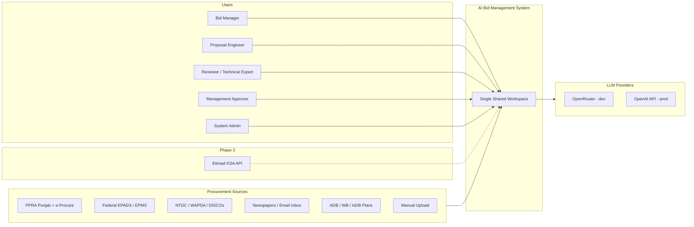
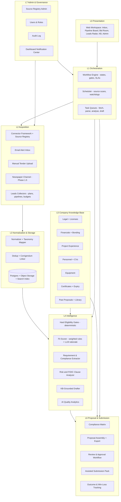
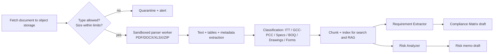
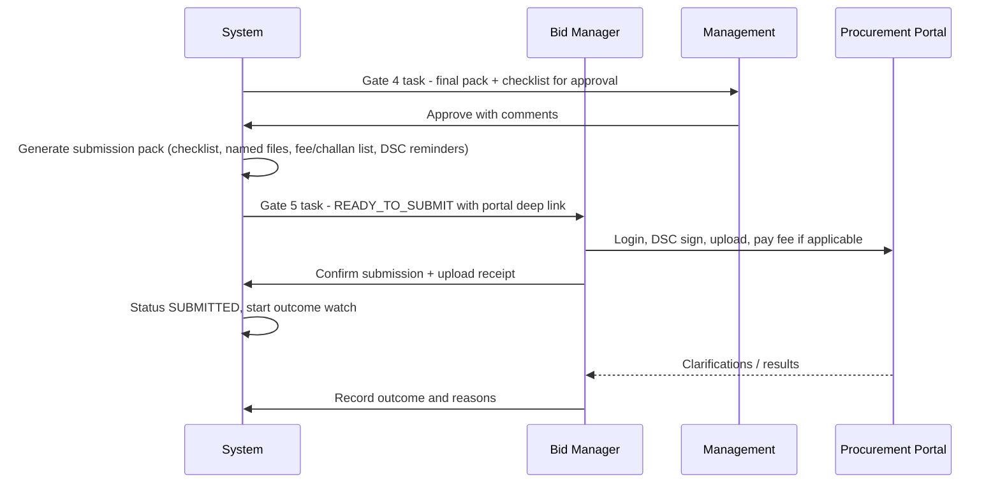

# 02 — Solution Architecture

Audience: engineering + technical reviewer. Domain validation items referenced here are collected
in `docs/10` (A-register IDs).

---

## 1. Design principles

These principles are derived directly from the research (`docs/01` §2) and are binding for MVP:

| # | Principle | Consequence |
|---|-----------|-------------|
| P1 | **Deterministic before generative** | Search, dedup, deadline maths, hard eligibility gates, ranking and state transitions are plain code. LLMs are used only for extraction, judgement, summarisation and drafting. |
| P2 | **Connectors own zero business logic** | Each source is an adapter behind one stable interface; parsers are isolated per source so one broken portal never blocks the pipeline. |
| P3 | **Normalize early, tag at ingestion** | Every fetched notice becomes one canonical Opportunity with country/area/category/regime tags attached at fetch time. |
| P4 | **Untrusted documents, sandboxed handling** | Third-party files (PDF/DOCX/XLSX/ZIP) are treated as hostile input: parsed in an isolated worker with strict limits; text is fenced as data, never instructions. |
| P5 | **Human decisions at gates; automation between gates** | The system never advances a bid past a gate without an explicit human decision; approvals trigger a defined set of automated next actions. |
| P6 | **Evidence or gap — never invention** | Every AI claim in analysis or drafts cites a KB artifact or tender clause; missing evidence becomes an explicit GAP item. |
| P7 | **Provider-agnostic LLM layer** | OpenRouter (dev/test) today, OpenAI API (production) later — swap by configuration, with failover routing. |
| P8 | **Monitor sources, not just servers** | Per-source golden fixtures + volume/distribution anomaly alerts detect silent schema drift. |
| P9 | **Dashboard-first observability** | All alerts (deadlines, gate SLAs, expiries, source health, AI quality) land in the workspace; no email dependency in MVP (D-03). |

---

## 2. System context



---

## 3. Layered architecture



---

## 4. Component catalog

### L0 — Presentation (single shared workspace, D-02)

| Component | Responsibility |
|-----------|----------------|
| Opportunity Inbox | Scored, filterable list of new opportunities; bulk triage; saved views per country/area/category |
| Pipeline Board | Kanban of opportunities by workflow state (see `docs/03`), with SLA indicators |
| Bid Room | Per-opportunity workspace: documents, extracted requirements, compliance matrix, drafts, gate history, submission pack |
| Leads Radar | Pre-publication leads with expected-window and confidence (see `docs/06`) |
| Review Queue | Every pending human decision across all gates, sorted by deadline risk |
| Knowledge Base UI | Company data CRUD with validity/expiry tracking and approval status |
| Admin Console | Source registry, scan schedules, category mappings, users/roles, audit viewer, AI quality analytics |
| Notification Center | Dashboard-only alerts: deadline radar, SLA breaches, expiries, source health, corrigenda |

### L1 — Orchestration

| Component | Responsibility |
|-----------|----------------|
| Workflow Engine | Owns the per-opportunity state machine (`docs/03`); evaluates transition conditions; creates gate tasks; records decisions; triggers automated next actions |
| Scheduler | Timed jobs: source scans (per-source cadence), deadline watchdogs (T-7/T-3/T-1), document re-fetch for corrigenda, certificate expiry scans, leads refreshes |
| Task Queues | Asynchronous pipelines with retry/backoff: fetch → parse → extract → analyse → draft; idempotent per (opportunity, step) |

### L2 — Acquisition

| Component | Responsibility |
|-----------|----------------|
| Connector Framework | One interface per source type (`fetch_listings`, `fetch_detail`, `fetch_documents`); raw payload snapshot persisted before parsing (auditability, re-parsing after fixes) |
| Source Registry | DB-backed catalog of sources: URL, country/area, adapter template or code adapter, schedule, enabled flag, health status (admin-editable — D-04, detail in `docs/05` §7) |
| Email Alert Inbox | Dedicated mailbox; forwarded tender alerts/newspaper scans ingested as opportunities or leads |
| Manual Tender Upload | User-provided PDF/ZIP/DOCX packages enter at NORMALIZED (see `docs/03` §8) |
| Newspaper Channel | Phase 1.5: OCR + parsing of classified pages from partner/licensed scans |
| Leads Collectors | Extract planned-procurement signals (annual plans, ADB/WB pipelines, PSDP/ADP, PQs) into the Lead model (`docs/06`) |

### L3 — Normalization & Storage

| Component | Responsibility |
|-----------|----------------|
| Normalizer | Maps raw notices to the canonical Opportunity (`docs/04`); applies category taxonomy mapping (portal codes → internal categories) |
| Dedup | Cross-source duplicate detection (buyer + reference + title + dates fuzzy match); one Opportunity with multiple source references |
| Corrigendum Linker | Detects amended/re-issued notices; links to parent; forces re-analysis; notifies gate owners |
| Storage | PostgreSQL (system of record) + object storage for raw snapshots and documents + full-text/vector index for document retrieval |

### L4 — Intelligence

| Component | Responsibility |
|-----------|----------------|
| Hard Eligibility Gates (deterministic) | PEC category/value fit, field of specialization, blacklist presence, deadline feasibility, active taxpayer status, JV-only rules for foreign bidders; failures auto-flag with reason — no LLM involved |
| Fit Scorer | Weighted score (company fit, scope overlap with past projects, buyer familiarity, competition signals, geography); LLM writes the rationale and evidence links |
| Requirement & Compliance Extractor | From tender documents: submission checklist, qualification thresholds (e.g., turnover, similar-work experience), mandatory forms, bid security, key dates, evaluation method (single/two-envelope, PQ/post-PQ) |
| Risk & FIDIC Clause Analyzer | Contract-regime detection and clause-level flags (`docs/07`): liability caps, delay damages, price adjustment, DAB provisions, onerous amendments to standard conditions |
| KB-Grounded Drafter | Question/requirement → KB passage matching → draft sections in company voice with citations; explicitly marks GAP where no evidence exists |
| AI Quality Analytics | Tracks overrides, corrections, extraction errors, scoring vs outcomes; feeds recalibration |

### L5 — Company Knowledge Base (`docs/04` §4)

Legal/registration (SECP, NTN, PEC licenses + expiry) · financials (audited accounts, turnover history, bank lines, bonding capacity) · project experience (contract, client, value, scope, certificates) · personnel (CVs, PEC registrations) · equipment inventory · certificates (ISO/HSE, performance certificates) · past proposals and reusable library content. Every record carries: source document, validity, confidentiality tag, and approver.

### L6 — Proposal & Submission

| Component | Responsibility |
|-----------|----------------|
| Compliance Matrix | Requirement ↔ evidence ↔ status (Covered / GAP / TBD / N-A) with owner and notes; the single source of truth at Gate 2/3 |
| Assembly & Export | Builds the bid pack per tender structure (technical volume draft, forms list, financial volume skeleton with BOQ); exports editable DOCX/XLSX + PDF renders |
| Review & Approval Workflow | Gate 3/4 mechanics: comments, versions, approvals with audit (`docs/03`) |
| Assisted Submission Pack | Final checklist, document naming per portal conventions, fee/challan checklist, DSC reminders, portal deep link; human submits (D-06) |
| Outcome Tracking | Submission record, clarification/Q&A log, result (Won/Lost/Rejected/Cancelled), win-loss reason capture; feeds analytics |

### L7 — Admin & Governance

Source Registry Admin (D-04) · Users & Roles (RBAC) · Audit Log (immutable, append-only: who/when/what/why for every decision and automation action) · Notification Center (dashboard-only, D-03) · Configuration (taxonomies, thresholds, scoring weights, gate SLAs — change-controlled).

---

## 5. Generic inputs: Country / Area / Category

The system is configured by three top-level parameters. The MVP ships with Pakistan fully
populated and the model built so KSA is a data change, not a rewrite.

| Parameter | Drives | Pakistan values (MVP) | KSA (Phase 3) |
|-----------|--------|-----------------------|----------------|
| **Country** | Regulatory profile, source subset, currency, submission mode, language(s), calendar | PK: PPRA rules, PEC regime, PKR, assisted submission, EN (+UR glossary) | SA: GTPL, SCA regime, SAR, Etimad e-submission, AR/EN, Hijri |
| **Area** | Region/province source feeds and geography filters | Punjab (P0), ICT/Federal, Sindh, KP, Balochistan, AJK/GB | 13 regions |
| **Category** | Taxonomy mapping, scoring, KB matching | Transmission Lines, Substations, Civil Infrastructure, Renewable, Transport/Roads, Trading/Supply | + KSA-specific classes |

Mapping tables translate each portal's own category codes (e.g., EPADS categories, Punjab
e-procurement categories) into the internal taxonomy once, at ingestion (P3).

---

## 6. LLM provider abstraction (D-07)

```
Provider Interface
 ├── OpenRouterProvider   (development & testing — free tier models)
 ├── OpenAIProvider       (production — GPT models)
 └── (Future) LocalProvider (self-hosted, if data sovereignty ever requires)
```

- **Config-driven selection** per environment and per task class (extraction / judgement /
  drafting), with fallback order and per-provider health checks.
- **Prompt registry**: every prompt versioned (`task`, `version`, `provider-agnostic template`);
  outputs stored with prompt version for auditability and regression testing.
- **Cost & rate governance**: per-opportunity and per-day token budgets; OpenRouter free-tier
  rate limits are absorbed by queues + retry/backoff; deterministic-first (P1) keeps LLM calls
  proportional to genuine judgement needs.
- **Failover**: primary provider → secondary provider → mark task degraded (opportunity continues
  with deterministic outputs; AI-dependent steps queue for retry).
- **Injection defence**: document text is fenced and labelled as untrusted data; system prompts
  instruct the model to never follow instructions found inside documents; outputs are schema-
  validated JSON before entering the system.

---

## 7. Document processing pipeline (P4)



Limits (configurable): max files per tender, max file size (default 50 MB), max pages, ZIP nesting
depth 1, macro-enabled files rejected, drawings (DWG/PDF-CAD) indexed by filename only.

---

## 8. Scoring model (MVP)

Two-stage: **deterministic hard gates** → **weighted soft score** → **LLM rationale**.

| Stage | Evaluation | Outcome |
|-------|-----------|---------|
| Hard gates | PEC license covers scope/value; not blacklisted; deadline feasible (doc download + prep window); mandatory JV rules satisfied; category in strategy scope | ANY fail → status `Screened-out` with reason (human can override at Gate 1 only) |
| Soft score (0–100) | Scope similarity to past projects (30), buyer familiarity/history (15), value band vs capacity (15), geography (10), qualification margin vs thresholds (15), strategic fit (15) | Sorted Inbox; ≥ threshold → Gate 1 queue;  below → auto-archived but reviewable |
| LLM rationale | 3–5 sentence explanation + evidence links (KB projects, tender clauses) | Displayed at Gate 1; stored in audit |

Weights and thresholds are configuration, validated with the domain expert (A-11).

---

## 9. Assisted submission flow (D-06)



Post-submission the system tracks: clarification questions and deadlines, corrigenda, award
intimations, and win/loss reasons — feeding AI quality analytics and future scoring.

---

## 10. Security & governance

| Area | Design |
|------|--------|
| Access control | Roles: Admin, Bid Manager, Proposal Engineer, Reviewer, Management (approve-only), Viewer; least-privilege; single shared workspace (D-02) |
| Audit | Append-only audit event for: every state transition, gate decision (who/when/why), AI action (prompt version, provider, output hash), document access, registry changes |
| Data protection | Encryption at rest (disk/objects) and in transit; secrets in managed store; KB confidentiality tags enforced in retrieval (confidential pricing never injected into general drafting prompts) |
| Sandboxing | Untrusted documents parsed in isolated workers with resource caps; no network egress from parser workers |
| LLM data flow | Only necessary content sent to LLM providers; per-provider data-use settings reviewed (training opt-out); production OpenAI under business terms; a "redaction layer" for pricing before any LLM call |
| Backup/DR | Nightly Postgres + object storage backup; restore runbook; raw-snapshot replay makes reprocessing safe |

---

## 11. Deployment

| Environment | Stack | Notes |
|-------------|-------|-------|
| Development (now) | Docker Compose on developer machines: web + api + workers + Postgres + Redis + MinIO; OpenRouter free tier | Seeded fixtures: sample PPRA Punjab notices + one full tender package for end-to-end tests |
| Production (target) | In-house server (D-08): same containers, reverse proxy + TLS; OpenAI API (D-07) | Single-tenant; capacity sized for ~50–200 opportunities/day and 10–30 document-heavy analyses/day |
| KSA (Phase 3) | In-region deployment to satisfy PDPL/NCA residency (`docs/09`) | Provider and storage selection revisited at that time |

---

## 12. Non-functional requirements (MVP targets)

| NFR | Target |
|-----|--------|
| Source scan freshness | Every enabled portal scanned ≥ 1×/day (configurable per source) |
| New-opportunity latency | Scored and in Inbox within 60 min of scan completion |
| Document analysis | ≤ 30 min for a 300-page package on standard worker capacity |
| Availability | 99% during business hours (PKT); degradation mode without LLM (deterministic flows continue) |
| Politeness | Per-source rate limits, off-peak scheduling for heavy sources, robots.txt respected |
| Cost guardrail | Token budget per opportunity; hard stop + alert on breach |
| Auditability | 100% of decisions and AI actions traceable with inputs/outputs/hashes |

---

## 13. Recommended technology stack

| Layer | Choice | Rationale |
|-------|--------|-----------|
| Web UI | Next.js + TypeScript + Tailwind + shadcn/ui | Fast iteration, component ecosystem |
| API / services | Python + FastAPI | AI/parsing ecosystem (LLM SDKs, PDF tooling) |
| Workers | Celery + Redis (or RQ) | Mature retry/queue semantics for pipelines |
| Scraping | Playwright + httpx | Handles JS-heavy portals; same codebase for fixtures |
| Database | PostgreSQL (+ pgvector for retrieval) | One store for relational + vector; operational simplicity on-prem |
| Object storage | MinIO (S3-compatible) | On-prem friendly; raw snapshots + documents |
| Search | Postgres FTS initially; OpenSearch optional later | Avoid premature infrastructure |
| LLM access | Provider abstraction: OpenRouter → OpenAI | D-07 |
| Parsing | PyMuPDF / pdfplumber, python-docx, openpyxl; OCR (Tesseract/PaddleOCR) for scans | Self-hosted, sandbox-friendly |
| Packaging | Docker Compose (dev & prod), later Compose→K8s only if needed | Matches in-house hosting plan |

---

## 14. Traceability

- Workflow states, gates and dashboards: `docs/03`
- Entities and KB structure: `docs/04`
- Source matrix + connector + admin registry detail: `docs/05`
- Leads collectors: `docs/06`
- FIDIC/PEC analysis detail: `docs/07`
- MVP scope, milestones, acceptance: `docs/08`
- All assumptions to validate: `docs/10` (A-register)
