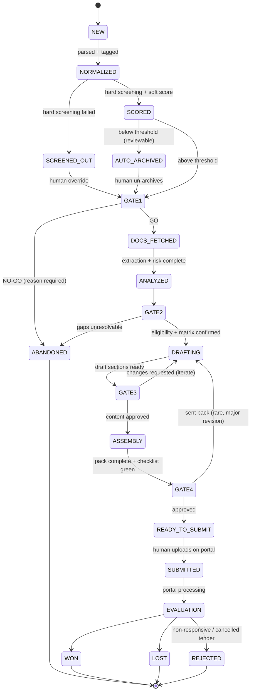
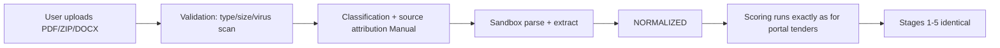

# 03 — Workflow & Review Stages

This is the **decision architecture** (per the Zuci lesson: design decisions before agents). It
defines every state an opportunity passes through, the five mandatory review stages, what the system
does automatically on each decision, and how exceptions are handled.

Audience: Business Domain Expert (primary), engineering (secondary). Validate items are listed in
`docs/10`.

> **Terminology.** A *stage* is a mandatory human checkpoint. The user-facing system says **Stage 1–5**
> and never "gate"; the internal workflow states (`GATE1`…`GATE5`), the `gate` column and the
> `/api/gates` routes keep their names, because the audit trail, the state machine and every existing
> record depend on them. This document uses the user-facing word throughout, and shows the internal
> state name once, where the two need to be reconciled.

---

## 1. Lifecycle in words (AHTE worked example)

> The Punjab PPRA connector scans overnight and finds a Notice Inviting Tenders for a 132 kV grid
> station extension. The system normalises it, checks AHTE's PEC C-A licence covers the scope and
> value, finds no blacklist hits, and scores it 78/100 with a rationale citing two similar NTDC
> substation projects from the KB. It appears in the **Inbox** at 08:00 and creates **Stage 1**.
> The Bid Manager approves pursuit. The system immediately downloads the full package, extracts
> the submission checklist and qualification thresholds, drafts a compliance matrix, and detects
> the contract regime (PEC standard document with FIDIC-based GCC, single-stage two-envelope).
> Risk flags identify a 15-day clarification window and an onerous delay-damages cap proposal.
> **Stage 2** asks the Proposal Engineer to confirm the matrix and resolve two GAPs (missing ISO
> certificate scan, unsigned JV MoU). After resolution, drafting starts: technical approach,
> project references and CVs are drafted from the KB with citations. **Stage 3** is a content
> review; edits are logged. The pack (DOCX + XLSX BOQ skeleton + forms checklist) assembles.
> **Stage 4** management approval; then the **submission pack** is generated with named files, fee
> challan checklist and DSC reminders. **Stage 5**: the Bid Manager uploads on the portal, marks
> it SUBMITTED with the receipt. The system watches deadlines, clarifications and award news,
> and finally records WIN/LOSS with a reason — which recalibrates future scoring.

---

## 2. State machine

> The state names above are the **internal** workflow states (`GATE1`…`GATE5`) and are shown unchanged
> because that is what the database stores. The interface labels them **Stage 1**…**Stage 5**.

**Corrigendum / deadline exception handling** (orthogonal to the main flow):

- New corrigendum detected → opportunity flagged, re-analysis task created, **current stage owner
  notified**; states after `ANALYZED` re-open `ANALYZED` so Stage 2 evidence is refreshed.
- Deadline radar: T-7 / T-3 / T-1 dashboard escalations until `SUBMITTED` or `ABANDONED`.
- Bid security / fee deadlines tracked as checklist items with their own due dates.

---

## 3. The five review stages

Every stage is a **task object**: owner (role), due date/SLA, inputs shown, decision options,
mandatory reason codes, audit record. Stages live in the **Review Queue** sorted by deadline risk.

### Stage 1 — Triage / Go-No-Go

| | |
|---|---|
| **Purpose** | Decide whether AHTE pursues the opportunity |
| **Owner** | Bid Manager (configurable; management for high-value tenders above a threshold) |
| **Inputs shown** | Fit score with the plain-language summary (scope, experience, financial and bid-security requirements, deadline, key personnel, other conditions) — each point carrying the clause or page it came from; hard-screening results; deadline; buyer history; competition notes |
| **Decision options** | `GO` (proceed to fetch/analyse) · `NO-GO` (abandon, reason code + comment) · `OVERDUE-AUTO NOTE` |
| **Default SLA** | 1 working day (config: 4 hours for deadline < 7 days) |
| **On GO (automated next actions)** | Download full document package → sandbox parse → extraction + risk analysis queued → Stage 2 task created with ETA → deadline entries in radar → bid folder created |
| **On NO-GO** | Reason captured (feeds analytics); opportunity archived; optionally added to Lead watchlist (buyer/category) |

### Stage 2 — Eligibility & Compliance Confirmation

| | |
|---|---|
| **Purpose** | Human confirms the AI-extracted compliance matrix and resolves gaps |
| **Owner** | Proposal Engineer (technical expert co-review for qualification margins) |
| **Inputs shown** | Compliance matrix (requirement ↔ KB evidence ↔ status), extracted qualification thresholds vs AHTE data (turnover, similar experience, personnel, equipment), risk memo, FIDIC/PEC clause flags, bid security details |
| **Decision options** | `CONFIRMED` (all items Covered or consciously waived) · `GAPS EXIST` (assign owners + due dates; system tracks) · `ABANDON` (eligibility fail) |
| **Default SLA** | 2 working days |
| **On CONFIRMED (automated)** | Drafting job queued per tender structure; KB retrieval locked to cited evidence; GAP items converted to checklist tasks carrying into Stage 3 |
| **On GAPS EXIST** | System re-checks matrix as items close; Stage 2 stays open; escalations per SLA |

### Stage 3 — Draft Content Review

| | |
|---|---|
| **Purpose** | Professional review/editing of AI-drafted proposal content |
| **Owner** | Proposal Engineer + Technical Expert (per section assignment) |
| **Inputs shown** | Draft sections with inline citations to KB artifacts; per-section status (DRAFTED / GAP / EXCLUDED); diff view against any KB source used |
| **Decision options** | `APPROVED` (section) · `CHANGES REQUESTED` (comment → back to DRAFTING for that section) · `EXCLUDE` (leave to manual authorship) |
| **Default SLA** | 3 working days (config shrinks near deadline) |
| **On all sections approved (automated)** | Assembly job: pack build, form checklist verification, BOQ skeleton, page/format checks → Stage 4 task |

### Stage 4 — Final Approval

| | |
|---|---|
| **Purpose** | Management commitment: technical package + price + commercial terms |
| **Owner** | Management Approver (named authority; AHTE org chart TBD via A-register A-03) |
| **Inputs shown** | Complete pack preview, price sheet (human-entered in MVP), bid security arrangements, risk memo summary, compliance status, submission mechanics checklist |
| **Decision options** | `APPROVED` · `SENT BACK` (major revision → DRAFTING) · `NO-BID` (abandon with reason) |
| **Default SLA** | 1 working day |
| **On APPROVED (automated)** | Submission pack generated: final named files, checklist (all green), challan/fee list, DSC reminder, portal deep link → Stage 5 task created |

### Stage 5 — Submission Confirmation

| | |
|---|---|
| **Purpose** | Because portals require DSC/e-token and often physical fee instruments, the human executes the final submission (D-06) |
| **Owner** | Bid Manager |
| **Inputs shown** | Submission pack + step-by-step guide, portal deep link, checklist of what to upload where, fee instructions |
| **Decision options** | `SUBMITTED` (attach receipt/proof) · `BLOCKED` (reason: portal issue, fee, DSC → escalation) |
| **Default SLA** | Before T-1 of deadline; escalates continuously after |
| **On SUBMITTED (automated)** | Status → SUBMITTED; outcome watch starts (clarifications, corrigenda, results); deadline radar closes |

---

## 4. Automation matrix (what is automatic vs human)

| Step | Automatic | Human stage |
|------|-----------|-----------|
| Source scanning & ingestion | ✅ | — |
| Normalisation, dedup, corrigendum linking | ✅ | — |
| Hard eligibility screening | ✅ | Override only at Stage 1 (logged) |
| Fit scoring + summary | ✅ | Decision at **Stage 1** |
| Document download & sandbox parsing | ✅ (after GO) | — |
| Requirement extraction / compliance matrix draft | ✅ | Confirmation at **Stage 2** |
| Risk / FIDIC clause memo | ✅ | Reviewed at **Stage 2** |
| KB-grounded drafting | ✅ | Review/edit at **Stage 3** |
| Pack assembly, checklist, format checks | ✅ | — |
| Pricing | ❌ (human enters) | **Stage 4** approval |
| Portal submission | ❌ (assisted) | **Stage 5** |
| Outcome capture & analytics | ✅ (capture) | Reason codes by humans |

---

## 5. Roles & permissions

| Role | Can do | Notes |
|------|--------|-------|
| System Admin | Configure sources, taxonomies, thresholds, users; view audit | No bid decisions by default |
| Bid Manager | Stage 1, Stage 5; manage pipeline; reassign tasks | Default stage owner for triage/submission |
| Proposal Engineer | Stage 2, Stage 3 content; upload manual tenders; maintain KB drafts | — |
| Technical Expert / Reviewer | Stage 3 sections; advisory comments | Section-scoped assignment |
| Management Approver | Stage 4; view pipeline & analytics | Approval authority per value bands (A-03) |
| Viewer | Read-only dashboards | — |

---

## 6. Dashboard specifications (notification model = dashboard-only, D-03)

| View | Content | Alerting behaviour |
|------|---------|--------------------|
| **Opportunity Inbox** | New scored opportunities; filters: country/area/category, value band, source, deadline, score | Unread counts; deadline badges |
| **Pipeline Board** | Sections per stage, with the past-deadline tenders held apart (see §6.1); card shows score, deadline, stage owner, SLA timer | SLA breach → card turns red; daily summary counters on home |
| **Bid Room** | Everything for one opportunity: documents, matrix, drafts, risk memo, stages, pack | Stage tasks pinned; corrigendum banner |
| **Review Queue** | All pending stage tasks across opportunities, sorted by deadline risk | Primary daily work queue; empty state celebrated |
| **Leads Radar** | Pre-publication leads (`docs/06`) | Expected-window approaching; new signals |
| **Deadline Radar** | All T-7/T-3/T-1 events: stages, clarifications, fees, security, submission | Home-page banner counts |
| **Expiry Watch** | Licences, certificates, bank lines approaching expiry | Feeds Stage 2 evidence status |
| **AI Quality** | Override rate, extraction corrections, scoring vs outcome | Admin/mgmt review cadence (monthly) |

### 6.1 Past-deadline tenders are not in the active pipeline

A tender whose closing date has passed is no longer something the team can bid on, but it is still a
record the team has to find — for the award, for the post-bid review, and for the lesson about how
well it scored. So it is **moved out of the active pipeline into its own section**, not deleted and
not silently dropped.

The distinction the system draws is between a deadline that has passed and a decision that has been
made:

| State | Meaning | Where it sits |
|-------|---------|---------------|
| **Still open** | Deadline ahead, decision not taken | Active pipeline |
| **Past deadline** | Deadline passed, no decision recorded | Its own pipeline section |
| **Closed** | Decided — won, lost, rejected or abandoned | Closed pipeline section |

The split matters because a bid that was **screened out** and a bid that was **won** are different
things: the first never had a live deadline, the second was decided. Both are past their date, but
only one of them has an outcome. A record that was screened out on the day it closed is therefore
filed under *past deadline*, not under *closed*.

The section is a **view**, not a mutation: the record keeps its own workflow state and stays
reachable by its identifier, so no history is rewritten and nothing is lost. The filter is applied
server-side (`?deadline=open|expired`) so the counts on the board and the counts on the cards agree.

No email/SMS/WhatsApp in MVP (D-03). The architecture leaves a notification-event table so email
can be added later without rework.

---

## 7. Corrigendum, cancellation and re-tender handling

| Event | System behaviour |
|-------|------------------|
| Corrigendum received | Link to parent; re-run extraction diff; highlight changed requirements/dates; notify current stage owner; refresh deadline radar |
| Tender cancelled | Mark opportunity `CANCELLED`; retain documents/history; suggest Lead watch on buyer for re-tender |
| Re-tender of a known tender | Detect via dedup similarity; link history; pre-populate previous pack assets |
| Clarification Q&A posted | Ingest; diff against requirements; flag compliance matrix items affected |
| Clarification, amendment or addendum published | Kept as its own document against the tender (title, date, file, and the family it belongs to), listed on the tender's Documents tab and openable on its own — never folded into the notice text, because an amendment that moves a date has to be seen as a separate event |

---

## 8. Manual tender upload workflow (user requirement)

- Entry point: Bid Room "New from upload" or drag-drop in Inbox.
- If the buyer/reference matches an existing opportunity → offered as **attach documents** instead
  of a new record.
- Manual uploads carry an explicit `source=manual` tag and the uploader's identity in audit.
- Use cases covered: newspaper tender the system did not ingest, client-shared RFP, private-sector
  invitation, offline corrigendum package.

---

## 9. Stage SLA & escalation defaults (configurable — validate A-14)

| Setting | Default | Escalation |
|---------|---------|-----------|
| Stage 1 SLA | 1 working day (4 h if deadline < 7 days) | Reminder at 50%, breach alert to Bid Manager + management |
| Stage 2 SLA | 2 working days | Breach → deadline radar red |
| Stage 3 SLA | 3 working days | Breach → Bid Manager reassigns sections |
| Stage 4 SLA | 1 working day | Breach → named backup approver |
| Stage 5 SLA | T-1 of deadline | Continuous escalation from T-3 |
| Auto-archive score threshold | 40/100 (validate) | Reviewable list retained |

---

## 10. Audit record (per decision)

Every stage decision stores: opportunity ID, stage, decision, decided-by user, timestamp, reason
code, comment, inputs snapshot hash (score/matrix/draft versions shown), and the automation chain
it triggered. This satisfies the "audit trails for every decision" safeguard from the research
(`docs/01` §1.4) and is mandatory for any dispute about why a bid was or was not pursued.

---

## 11. What the bid team sees, and what the machine decided

The stage inputs above are what the system shows. Two of them were changed after the first domain
review, because "the model's opinion" was not something a bid manager could act on.

**The summary is structured, not a paragraph.** A free-text rationale can hide the one line that
matters — the turnover threshold, the experience count, the date. The summary is therefore split into
seven fixed sections — scope of work, experience requirements, financial requirements, bid security,
submission deadline, key personnel, and other important conditions — and every point under them
carries the clause or page it was read from. A point nobody can trace is not shown as a fact.

**The bid security amount is turned into an order-of-magnitude estimate, and labelled as one.**
Tenders rarely publish the contract value; they publish a bid security amount and the percentage of
the contract value it represents. Dividing one by the other gives an indicative BOQ value:

    Estimated BOQ value = Bid-security amount ÷ Bid-security percentage

The arithmetic is only performed when the percentage is stated **and** is tied to the same base value in
the document. A percentage that belongs to liquidated damages, retention money, an advance payment
or a performance guarantee is not a bid-security percentage, and using one of those would produce a
confident, wrong number. Where the document does not state the percentage, or states it ambiguously,
**nothing is assumed**: the field stays empty and the tender is flagged for a person to check. The
estimate is always shown as indicative and is stored separately from the tender's own value.

Where the percentage is stated matters as much as that it is stated. It lives in the **bidding
document** — the instructions to bidders and the bid data sheet — and not in the tender notice that
some portals publish alongside it. A record pointing at the notice can never carry an implied value,
which is why the record points at the bidding document (`docs/05` §11.2.1).

And the document has to actually be on file before any of it can be read. The Punjab portal refuses
connections from datacenter networks, so the deployment cannot fetch that document itself; the bid
desk's own machine does it (`docs/05` §11.2.1). Until the document arrives, the record says it is
waiting for it and **no bid security, no percentage and no implied value are shown** — the listing's
summary of the tender is not a document, and nothing may be worked out from it.

**The submission checklist is generated from the document, with references.** The checklist of what
must be submitted is read out of the bidding document, and each line carries the clause and page it
came from, so it can be checked against the source rather than trusted. Items are `pending`,
`complete` or `not applicable`, the team marks them as it works, and regenerating the checklist
after a re-analysis **keeps the team's marks** — matched by item, not by position.

