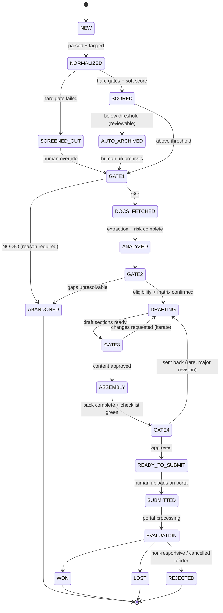
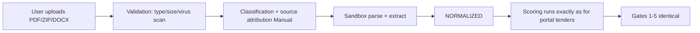

# 03 — Workflow & Human Gates

This is the **decision architecture** (per the Zuci lesson: design decisions before agents). It
defines every state an opportunity passes through, the five mandatory human gates, what the system
does automatically on each decision, and how exceptions are handled.

Audience: Business Domain Expert (primary), engineering (secondary). Validate items are listed in
`docs/10`.

---

## 1. Lifecycle in words (AHTE worked example)

> The Punjab PPRA connector scans overnight and finds a Notice Inviting Tenders for a 132 kV grid
> station extension. The system normalises it, checks AHTE's PEC C-A licence covers the scope and
> value, finds no blacklist hits, and scores it 78/100 with a rationale citing two similar NTDC
> substation projects from the KB. It appears in the **Inbox** at 08:00 and creates **Gate 1**.
> The Bid Manager approves pursuit. The system immediately downloads the full package, extracts
> the submission checklist and qualification thresholds, drafts a compliance matrix, and detects
> the contract regime (PEC standard document with FIDIC-based GCC, single-stage two-envelope).
> Risk flags identify a 15-day clarification window and an onerous delay-damages cap proposal.
> **Gate 2** asks the Proposal Engineer to confirm the matrix and resolve two GAPs (missing ISO
> certificate scan, unsigned JV MoU). After resolution, drafting starts: technical approach,
> project references and CVs are drafted from the KB with citations. **Gate 3** is a content
> review; edits are logged. The pack (DOCX + XLSX BOQ skeleton + forms checklist) assembles.
> **Gate 4** management approval; then the **submission pack** is generated with named files, fee
> challan checklist and DSC reminders. **Gate 5**: the Bid Manager uploads on the portal, marks
> it SUBMITTED with the receipt. The system watches deadlines, clarifications and award news,
> and finally records WIN/LOSS with a reason — which recalibrates future scoring.

---

## 2. State machine

**Corrigendum / deadline exception handling** (orthogonal to the main flow):

- New corrigendum detected → opportunity flagged, re-analysis task created, **current gate owner
  notified**; states after `ANALYZED` re-open `ANALYZED` so Gate 2 evidence is refreshed.
- Deadline radar: T-7 / T-3 / T-1 dashboard escalations until `SUBMITTED` or `ABANDONED`.
- Bid security / fee deadlines tracked as checklist items with their own due dates.

---

## 3. The five human gates

Every gate is a **task object**: owner (role), due date/SLA, inputs shown, decision options,
mandatory reason codes, audit record. Gates live in the **Review Queue** sorted by deadline risk.

### Gate 1 — Triage / Go-No-Go

| | |
|---|---|
| **Purpose** | Decide whether AHTE pursues the opportunity |
| **Owner** | Bid Manager (configurable; management for high-value tenders above a threshold) |
| **Inputs shown** | Score + LLM rationale with evidence links (KB projects, tender clauses); hard-gate results; deadline; buyer history; competition notes |
| **Decision options** | `GO` (proceed to fetch/analyse) · `NO-GO` (abandon, reason code + comment) · `OVERDUE-AUTO NOTE` |
| **Default SLA** | 1 working day (config: 4 hours for deadline < 7 days) |
| **On GO (automated next actions)** | Download full document package → sandbox parse → extraction + risk analysis queued → Gate 2 task created with ETA → deadline entries in radar → bid folder created |
| **On NO-GO** | Reason captured (feeds analytics); opportunity archived; optionally added to Lead watchlist (buyer/category) |

### Gate 2 — Eligibility & Compliance Confirmation

| | |
|---|---|
| **Purpose** | Human confirms the AI-extracted compliance matrix and resolves gaps |
| **Owner** | Proposal Engineer (technical expert co-review for qualification margins) |
| **Inputs shown** | Compliance matrix (requirement ↔ KB evidence ↔ status), extracted qualification thresholds vs AHTE data (turnover, similar experience, personnel, equipment), risk memo, FIDIC/PEC clause flags, bid security details |
| **Decision options** | `CONFIRMED` (all items Covered or consciously waived) · `GAPS EXIST` (assign owners + due dates; system tracks) · `ABANDON` (eligibility fail) |
| **Default SLA** | 2 working days |
| **On CONFIRMED (automated)** | Drafting job queued per tender structure; KB retrieval locked to cited evidence; GAP items converted to checklist tasks carrying into Gate 3 |
| **On GAPS EXIST** | System re-checks matrix as items close; Gate 2 stays open; escalations per SLA |

### Gate 3 — Draft Content Review

| | |
|---|---|
| **Purpose** | Professional review/editing of AI-drafted proposal content |
| **Owner** | Proposal Engineer + Technical Expert (per section assignment) |
| **Inputs shown** | Draft sections with inline citations to KB artifacts; per-section status (DRAFTED / GAP / EXCLUDED); diff view against any KB source used |
| **Decision options** | `APPROVED` (section) · `CHANGES REQUESTED` (comment → back to DRAFTING for that section) · `EXCLUDE` (leave to manual authorship) |
| **Default SLA** | 3 working days (config shrinks near deadline) |
| **On all sections approved (automated)** | Assembly job: pack build, form checklist verification, BOQ skeleton, page/format checks → Gate 4 task |

### Gate 4 — Final Approval

| | |
|---|---|
| **Purpose** | Management commitment: technical package + price + commercial terms |
| **Owner** | Management Approver (named authority; AHTE org chart TBD via A-register A-03) |
| **Inputs shown** | Complete pack preview, price sheet (human-entered in MVP), bid security arrangements, risk memo summary, compliance status, submission mechanics checklist |
| **Decision options** | `APPROVED` · `SENT BACK` (major revision → DRAFTING) · `NO-BID` (abandon with reason) |
| **Default SLA** | 1 working day |
| **On APPROVED (automated)** | Submission pack generated: final named files, checklist (all green), challan/fee list, DSC reminder, portal deep link → Gate 5 task created |

### Gate 5 — Submission Confirmation

| | |
|---|---|
| **Purpose** | Because portals require DSC/e-token and often physical fee instruments, the human executes the final submission (D-06) |
| **Owner** | Bid Manager |
| **Inputs shown** | Submission pack + step-by-step guide, portal deep link, checklist of what to upload where, fee instructions |
| **Decision options** | `SUBMITTED` (attach receipt/proof) · `BLOCKED` (reason: portal issue, fee, DSC → escalation) |
| **Default SLA** | Before T-1 of deadline; escalates continuously after |
| **On SUBMITTED (automated)** | Status → SUBMITTED; outcome watch starts (clarifications, corrigenda, results); deadline radar closes |

---

## 4. Automation matrix (what is automatic vs human)

| Step | Automatic | Human gate |
|------|-----------|-----------|
| Source scanning & ingestion | ✅ | — |
| Normalisation, dedup, corrigendum linking | ✅ | — |
| Hard eligibility gates | ✅ | Override only at Gate 1 (logged) |
| Fit scoring + rationale | ✅ | Decision at **Gate 1** |
| Document download & sandbox parsing | ✅ (after GO) | — |
| Requirement extraction / compliance matrix draft | ✅ | Confirmation at **Gate 2** |
| Risk / FIDIC clause memo | ✅ | Reviewed at **Gate 2** |
| KB-grounded drafting | ✅ | Review/edit at **Gate 3** |
| Pack assembly, checklist, format checks | ✅ | — |
| Pricing | ❌ (human enters) | **Gate 4** approval |
| Portal submission | ❌ (assisted) | **Gate 5** |
| Outcome capture & analytics | ✅ (capture) | Reason codes by humans |

---

## 5. Roles & permissions

| Role | Can do | Notes |
|------|--------|-------|
| System Admin | Configure sources, taxonomies, thresholds, users; view audit | No bid decisions by default |
| Bid Manager | Gate 1, Gate 5; manage pipeline; reassign tasks | Default gate owner for triage/submission |
| Proposal Engineer | Gate 2, Gate 3 content; upload manual tenders; maintain KB drafts | — |
| Technical Expert / Reviewer | Gate 3 sections; advisory comments | Section-scoped assignment |
| Management Approver | Gate 4; view pipeline & analytics | Approval authority per value bands (A-03) |
| Viewer | Read-only dashboards | — |

---

## 6. Dashboard specifications (notification model = dashboard-only, D-03)

| View | Content | Alerting behaviour |
|------|---------|--------------------|
| **Opportunity Inbox** | New scored opportunities; filters: country/area/category, value band, source, deadline, score | Unread counts; deadline badges |
| **Pipeline Board** | Kanban per state; card shows score, deadline, gate owner, SLA timer | SLA breach → card turns red; daily summary counters on home |
| **Bid Room** | Everything for one opportunity: documents, matrix, drafts, risk memo, gates, pack | Gate tasks pinned; corrigendum banner |
| **Review Queue** | All pending gate tasks across opportunities, sorted by deadline risk | Primary daily work queue; empty state celebrated |
| **Leads Radar** | Pre-publication leads (`docs/06`) | Expected-window approaching; new signals |
| **Deadline Radar** | All T-7/T-3/T-1 events: gates, clarifications, fees, security, submission | Home-page banner counts |
| **Expiry Watch** | Licences, certificates, bank lines approaching expiry | Feeds Gate 2 evidence status |
| **AI Quality** | Override rate, extraction corrections, scoring vs outcome | Admin/mgmt review cadence (monthly) |

No email/SMS/WhatsApp in MVP (D-03). The architecture leaves a notification-event table so email
can be added later without rework.

---

## 7. Corrigendum, cancellation and re-tender handling

| Event | System behaviour |
|-------|------------------|
| Corrigendum received | Link to parent; re-run extraction diff; highlight changed requirements/dates; notify current gate owner; refresh deadline radar |
| Tender cancelled | Mark opportunity `CANCELLED`; retain documents/history; suggest Lead watch on buyer for re-tender |
| Re-tender of a known tender | Detect via dedup similarity; link history; pre-populate previous pack assets |
| Clarification Q&A posted | Ingest; diff against requirements; flag compliance matrix items affected |

---

## 8. Manual tender upload workflow (user requirement)

- Entry point: Bid Room "New from upload" or drag-drop in Inbox.
- If the buyer/reference matches an existing opportunity → offered as **attach documents** instead
  of a new record.
- Manual uploads carry an explicit `source=manual` tag and the uploader's identity in audit.
- Use cases covered: newspaper tender the system did not ingest, client-shared RFP, private-sector
  invitation, offline corrigendum package.

---

## 9. Gate SLA & escalation defaults (configurable — validate A-14)

| Setting | Default | Escalation |
|---------|---------|-----------|
| Gate 1 SLA | 1 working day (4 h if deadline < 7 days) | Reminder at 50%, breach alert to Bid Manager + management |
| Gate 2 SLA | 2 working days | Breach → deadline radar red |
| Gate 3 SLA | 3 working days | Breach → Bid Manager reassigns sections |
| Gate 4 SLA | 1 working day | Breach → named backup approver |
| Gate 5 SLA | T-1 of deadline | Continuous escalation from T-3 |
| Auto-archive score threshold | 40/100 (validate) | Reviewable list retained |

---

## 10. Audit record (per decision)

Every gate decision stores: opportunity ID, gate, decision, decided-by user, timestamp, reason
code, comment, inputs snapshot hash (score/matrix/draft versions shown), and the automation chain
it triggered. This satisfies the "audit trails for every decision" safeguard from the research
(`docs/01` §1.4) and is mandatory for any dispute about why a bid was or was not pursued.
