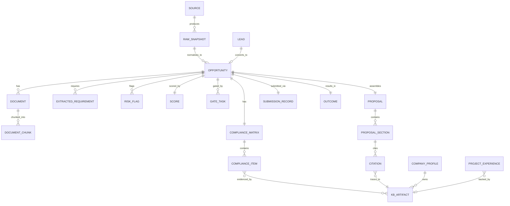

# 04 — Data Model & Company Knowledge Base

Audience: engineering (primary), domain expert (validation of KB fields and evidence rules).

The model is **OCDS-inspired**: we adopt the Open Contracting Data Standard's core ideas (one
contracting process = one record; releases/amendments instead of overwrites; stable identifiers;
source provenance) and extend where needed for bid management (compliance, gates, drafts).

---

## 1. Canonical Opportunity model

Every fetched notice — from any source, any country — becomes exactly one `Opportunity` record
with source references. Core fields:

| Group | Field | Notes |
|-------|-------|-------|
| Identity | `opportunity_id` | Internal stable ID |
| | `ocid_like_key` | Deterministic key from buyer + reference + year (dedup anchor) |
| | `source_refs[]` | Every source record that maps here (portal, newspaper, email, manual) |
| Classification | `country`, `area`, `city` | Drives filters and KSA/PK profiles |
| | `category_internal` | Internal taxonomy (Transmission Lines, Substations, Civil, Renewable, Transport, Supply) |
| | `category_source[]` | Original portal category codes (kept for audit/mapping QA) |
| | `tender_type` | Works / Goods / Services / EOI / PQ / RFP / Auction-Disposal |
| | `procurement_regime` | `NCB`, `ICB`, `single-stage-one-envelope`, `single-stage-two-envelope`, `TSTE`, donor rules if detected |
| Buyer | `buyer_name`, `buyer_org_path` | e.g., NTDC under Ministry of Energy (Power Division) |
| | `buyer_id` | Link to Buyer entity (history, watchlists) |
| Description | `title`, `description`, `lots[]` | As published |
| Value | `estimated_value`, `currency`, `value_band` | Parsed where stated |
| Dates | `published_at`, `document_sale_close`, `clarification_deadline`, `submission_deadline`, `opening_at` | All timezone-normalised (PKT default) |
| Eligibility (extracted) | `pec_category_required`, `specialization`, `prequal_required`, `qualification_thresholds{}` | Turnover, similar-work value/count, personnel, equipment, JV rules |
| Security/Fees | `bid_security_amount`, `bid_security_form[]`, `tender_fee`, `payment_methods[]` | Chalan/bank draft/BG notes |
| Documents | `documents[]` | Link to Document entities with classification |
| Status | `notice_status` | Published / Corrigendum / Cancelled / Awarded / Retendered |
| Pipeline | `lead_id` (nullable) | Link back to originating Lead (`docs/06`) |
| Ingest metadata | `first_seen_at`, `last_seen_at`, `raw_snapshot_refs[]`, `parser_version` | Provenance + re-parse capability |
| Workflow | `state`, `gate_tasks[]`, `scores[]`, `compliance_matrix_ref`, `risk_memo_ref`, `proposal_refs[]`, `submission_ref`, `outcome_ref` | See `docs/03` |

### 1.1 Deduplication rules

- Match key: normalised `buyer_name` + tender reference + fiscal year (strong), fallback fuzzy
  title similarity + deadline proximity (weak).
- Same tender on a portal and in a newspaper → one Opportunity, two `source_refs`, sources listed
  in UI with links.
- Conflicts (e.g., differing deadlines) → field-level confidence: portal > newspaper > email;
  discrepancy raised as a data-quality alert.

### 1.2 Corrigendum handling

- A notice that references an earlier tender number is linked as `amends → parent`.
- Field-level diff generated (dates, requirements, BOQ); changes highlighted in Bid Room and
  surfaced on the dashboard to the current gate owner.
- Parent opportunity keeps full history; analysis artifacts invalidated where affected; re-analysis
  task queued automatically.

---

## 2. Entity catalog (MVP)

### Acquisition & pipeline

| Entity | Purpose |
|--------|---------|
| `Source` | Registry row: portal/source metadata, adapter, schedule, enabled, health (`docs/05` §7) |
| `RawSnapshot` | Immutable fetched payload (HTML/PDF/JSON) with hash, URL, fetched_at, parser_version |
| `Lead` | Pre-publication signal (`docs/06`): buyer, description, expected window, confidence, value estimate, links |
| `LeadSourceEvidence` | The artifact a lead was extracted from (annual plan PDF, ADB plan row, PSDP line) |

### Opportunity & intelligence

| Entity | Purpose |
|--------|---------|
| `Opportunity` | Canonical record (§1) |
| `Document` | Tender attachment: type, classification (ITT/GCC-PCC/Specs/BOQ/Drawings/Forms), file ref, parsed status |
| `DocumentChunk` | Retrieval unit: text, page/clause anchor, embedding (for RAG + search) |
| `ExtractedRequirement` | One matrix row source: requirement text, category (form/qualification/technical/commercial), clause anchor, mandatory flag |
| `RiskFlag` | Clause-level or commercial risk with severity, evidence anchor, category (`docs/07` lists categories) |
| `Score` | Hard-gate result + soft sub-scores + total + LLM rationale + prompt version |
| `ComplianceItem` | Requirement ↔ KB evidence ↔ status (Covered/GAP/TBD/N-A) ↔ owner ↔ notes |
| `ComplianceMatrix` | Ordered set of ComplianceItems + status rollup per opportunity |

### Workflow & governance

| Entity | Purpose |
|--------|---------|
| `WorkflowRun` | Current state, history of transitions per opportunity (append-only) |
| `GateTask` | Gate number, owner role/user, SLA, decision, reason code, comment, decided_at |
| `DecisionAudit` | Immutable decision/automation record (see `docs/03` §10) |
| `NotificationEvent` | Emitted dashboard events (deadline, SLA, expiry, corrigendum, health) |
| `User`, `Role`, `Assignment` | RBAC and task routing |
| `AIMetrics` | Overrides, corrections, extraction errors, scoring vs outcome (per opportunity, aggregated) |

### Proposal & submission

| Entity | Purpose |
|--------|---------|
| `Proposal` | Pack for an opportunity: volumes, sections, exports |
| `ProposalSection` | Section: requirement ref, status (DRAFTED/GAP/EXCLUDED/APPROVED), content, citations[] |
| `Citation` | Section ↔ KB artifact or tender clause linkage (evidence trail) |
| `SubmissionRecord` | Pack version, checklist state, fee/security confirmation, submitted_at, proof, portal ref |
| `Outcome` | WON/LOST/REJECTED/CANCELLED, reason codes, competitor/price intelligence (optional fields) |

### Company Knowledge Base

| Entity | Purpose |
|--------|---------|
| `CompanyProfile` | Legal identity: SECP reg, NTN, addresses, PEC licences (category, field, expiry) |
| `FinancialYearRecord` | Audited turnover, net worth, profit, bank references/limits, bonding capacity |
| `ProjectExperience` | Contract no, client, scope, value, dates, role, country, funded-by (e.g., ADB), certificate ref, keywords |
| `Personnel` | CVs, PEC registration, key qualifications, availability |
| `EquipmentItem` | Owned/leased, capacity, condition, location |
| `CompanyCertificate` | ISO/HSE/training/etc., issuer, validity, file |
| `LibraryDocument` | Past proposals, standard texts, policies, organograms, JV agreements (reusable content) |
| `KBArtifact` | Base wrapper: type, file ref, validity dates, confidentiality tag, approver, version |

### ER overview

---

## 3. Evidence linking model (the core rule)

> **Every claim that leaves this system is traceable.** A compliance item, draft sentence, or
> qualification statement either cites a `KBArtifact`/tender clause, or it is a **GAP** shown to a
> human.

- Citations are stored structurally (`Citation` entity), not only inline text, so the review UI
  can show "this sentence came from ProjectExperience #214, certificate scan page 3".
- Retrieval respects **confidentiality tags**: pricing/margin material never enters drafting
  prompts unless the section is price-related and the user is authorised.
- Drafting policy: no citation → no content. The drafter marks the slot `GAP — evidence needed`
  and the flow proceeds (human authors or supplies evidence).

---

## 4. Company Knowledge Base design (detail)

### 4.1 Sections and required fields

**A. Legal & registration**
- SECP incorporation number/date; NTN; PEC licence(s): category (e.g., C-A No Limit), fields,
  licence no, **expiry date (alerted at T-60/T-30 days)**; provincial registrations; tax status
  (active taxpayer refs); power of attorney templates.

**B. Financial**
- Last 3–5 audited years: turnover, net worth, profit/loss, bank; current credit lines (banks,
  limits, expiry); **bonding facility statements** (capacity, utilised, available); auditor name.
- Maps directly to prequalification "Financial Soundness" scoring and to bid security planning.

**C. Project experience**
- Per project: contract no, client (with entity link), scope narrative (2–3 sentences +
  keywords), contract value, currency, dates (award/completion), role (sole/JV/associate),
  funding source (ADB/WB/PSDP), location (country/area), completion certificate ref, performance
  highlights, personnel/equipment used, photos optional.
- This is the primary feed for: similar-work thresholds, reference forms, technical narrative,
  and lead matching (buyer history).

**D. Personnel**
- Per person: CV (file + structured: education, PEC reg no, years, key projects), position,
  certifications, availability. Maps to prequalification "Personnel Capabilities".

**E. Equipment**
- Per item: description, capacity/spec, qty, owned/leased, age, location, current project.
  Maps to "Equipment Capabilities".

**F. Certificates**
- ISO 9001/14001/45001, HSE, training, registrations with expiry dates and scans.

**G. Library**
- Past prequalification dossiers, past proposals (indexed by client/category/year), standard
  method statements, HSE plans, QA/QC plans, organograms, JV/consortium agreements, insurance
  policies.

### 4.2 KB maintenance workflow

1. **Ingest**: Proposal Engineer uploads artifacts; structure extracted (AI-assisted) for review.
2. **Verify**: a second role confirms structured fields against the document (esp. financials,
   certificates, contract values).
3. **Approve**: record becomes `Approved` (only approved records are usable as evidence).
4. **Expire**: validity dates drive Expiry Watch; expired artifacts auto-downgrade evidence status
   to `STALE` and cannot back a confirmed compliance item.
5. **Version**: new certificate supersedes old; history retained (audit).

### 4.3 Data quality rules

| Rule | Enforcement |
|------|-------------|
| Every KB artifact has a file, owner, approver, validity, confidentiality tag | Schema-enforced |
| Financial records require auditor reference + year | Schema-enforced |
| Project values/currency/dates required for any project used in qualification claims | Matrix evidence check |
| Duplicate detection on personnel names / contract numbers | Ingest-time warning |
| Missing mandatory fields block `Approved` status | Workflow rule |

---

## 5. Retention & archival

- Opportunities and their raw snapshots: retained indefinitely (cheap, enables retraining/audit).
- Documents: retained with tender history; large drawings may move to cold storage after outcome.
- Audit events and gate decisions: never deleted.
- KB artifacts: superseded versions archived, not deleted (dispute defence).
- Personal data (CVs): access-controlled; departure handling per HR policy (config A-21).
