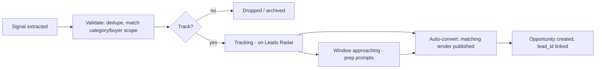

# 06 — Unpublished Leads Pipeline

Audience: domain expert + management (primary), engineering (secondary).

**Why this exists:** every commercial aggregator in Pakistan lists *published* tenders. The
system's edge is seeing work **before it is advertised** — planned procurements, donor pipelines
and budget signals — so AHTE can prepare (licences, JVs, equipment, bank lines) and position early.
By the time a tender publishes, preparation time is the difference between bidding and watching.

---

## 1. Lead sources (verified availability)

| # | Source | Signal extracted | Method | Refresh | Reliability tier |
|---|--------|------------------|--------|---------|------------------|
| L1 | **Annual Procurement Plans** — EPADS (`epads.gov.pk/annual-plans`), PPRA Punjab required plans | Planned procurement: agency, description, quantity, provisional value, planned dates/quarter | Table + PDF parsing; plans are also published per-agency | Weekly | High (mandated) |
| L2 | **ADB procurement plans & project documents** (`adb.org` per-project) | 18-month lookahead rows: contract description, method, estimated value, **planned advertisement date** | PDF plan parsing + project page monitoring | Weekly | High (official) |
| L3 | **World Bank / IsDB pipelines** | Project approval → procurement notices to follow | Project page monitoring | Weekly | Medium-High |
| L4 | **PSDP (federal) / ADP (Punjab) budget documents + PC-I approvals** | Budget allocations and approved schemes = tenders months later | PDF/HTML extraction, keyword + buyer matching | Per budget cycle + monthly review | Medium |
| L5 | **Prequalification notices** | PQ = main tender to follow in weeks | Normal pipeline treats PQ as its own opportunity **and** as a parent-lead | Daily (from P0/P1 sources) | High |
| L6 | **Buyer intelligence** — NTDC/WAPDA/DISCOs news, board approvals, press | Project announcements, NOLs, loan signings (e.g., new ADB tranche) | Buyer-site monitoring + email inbox | Weekly | Medium |
| L7 | **Newspaper notices-of-intent / pre-qualification ads** | Early advertisements not yet on portals | Same channel as tenders (`docs/05` §6) | Daily | Medium |
| L8 | **Private sector** — K-Electric, IPPs, CPEC-linked works | Direct invitations, private RFPs | Email inbox + relationship capture (manual entry) | Ad hoc | Low-Medium |
| L9 | **(KSA) Etimad "upcoming tenders"** via developer API | Planned competitions | API product | Phase 3 (`docs/09`) | High |

---

## 2. Lead model (summary; entities in `docs/04` §2)

| Field | Example |
|-------|---------|
| `lead_id` | L-2026-0142 |
| `source` | L2 (ADB procurement plan v13) |
| `buyer` | NTDC |
| `description` | "Procurement of 220 kV substation equipment — Nowshera & Jamrud" |
| `category_internal` | Substations |
| `area` | Federal / KP (site) |
| `expected_window` | Q1 2027 (planned advertisement date if stated) |
| `estimated_value` | US$ 12.4 M (plan figure) |
| `confidence` | Tier + extraction confidence (see §3) |
| `evidence` | Plan page/section anchor + link + snapshot |
| `status` | Signal → Validated → Tracking → Converted / Dropped / Expired |
| `watch_hint` | What to prepare now (e.g., equipment availability, JV partner) |

---

## 3. Lead lifecycle

**Auto-conversion rule:** when a new Opportunity normalises and fuzzy-matches a tracking lead on
`buyer + category + description keywords (± planned window)`, the system links them, marks the
lead `Converted`, and shows "originated from lead" in the Bid Room (the pre-positioned context —
plan reference, expected scope — is displayed to the Gate 1 owner).

---

## 4. Confidence tiers

| Tier | Sources | Meaning shown on radar |
|------|---------|------------------------|
| High | L1, L2, L5, L9 | Advert expected as planned; prepare actively |
| Medium | L3, L4, L6, L7 | Directional; watch monthly |
| Low | L8 | Relationship-based intelligence; manual follow-up |

Extraction confidence (per item) is separate: a plan row parsed with exact advertisement date
scores high; a PSDP line needing inference scores lower. Both are displayed.

---

## 5. Leads Radar dashboard

| Panel | Content |
|-------|---------|
| Upcoming (0–3 months) | Leads with window opening soon; prep checklists (PEC/registrations/JV/equipment) |
| Horizon (3–12 months) | Full tracking list, filterable by category/area/buyer/value |
| Fresh signals | Newly extracted leads this week (validation queue for Bid Manager) |
| Conversion watch | Leads whose window has passed without publication → auto-prompt to check buyer/news |
| Prepare-now suggestions | Derived: certificate expiries vs expected windows; equipment availability; JV needs for donor-funded PQs |

---

## 6. Worked example (thread used across the pack)

> **Signal (L2):** ADB *Power Transmission Strengthening Project* procurement plan lists
> "220 kV substation equipment/works, Nowshera & Jamrud" with a planned advertisement date.
> **Validate:** category Substations (AHTE fits), buyer NTDC (known), value within C-A scope.
> **Track:** radar shows Q-window; prep prompt: 220 kV experience already in KB; equipment not
> needed (works contract); update bank line for bid security.
> **Convert:** NTDC IFB publishes (e.g., pattern `ADB-PTSP-05-2024`); system links lead →
> opportunity; Gate 1 sees "originated from plan row, expected 2024-12" context.
> **Outcome:** bid submitted (assisted); result recorded; lead shows full conversion chain for
> management analytics.

---

## 7. Manual lead entry

Not everything is machine-readable: Board meeting notes, consultant briefings, JV partner
intelligence. The Bid Room offers "Add Lead" (same fields as §2) with evidence attachment; manual
leads are Tier Low unless a Bid Manager raises confidence.

---

## 8. Metrics (feeds management dashboard)

- Leads extracted / validated / tracked per month by tier and source.
- **Conversion rate**: tracked leads that became published tenders (validates source quality).
- **Lead-to-bid rate**: converted opportunities that reached submission (validates preparation value).
- Preparation lead time: days between lead first seen and tender publication (target: ≥ 60 days).
